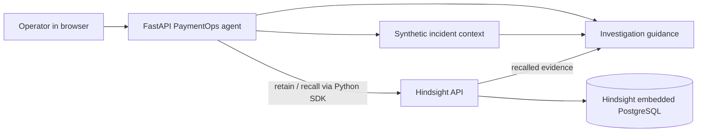

# From Stateless Payments to Hindsight-Powered Memory

PaymentOps Memory Agent is a small local application demonstrating how a payment investigation can consult a previous resolved incident instead of beginning with only the current error. Hindsight is the actual integrated persistent memory component. Hyperswitch, RocketRide, and HydraDB are not integrated; their evaluation is documented below.

All payment data in this project is synthetic. It does not connect to a processor and does not initiate, retry, route, or reconcile payments.

## Problem

A stateless assistant can explain a Stripe timeout from the current incident fields. It cannot cite the Store A timeout that the team previously resolved by routing through another processor. This demo puts the prior experience in Hindsight, asks Hindsight to recall it for Store B, and displays the returned memory next to the resulting guidance.

## Architecture



The baseline endpoint does not call Hindsight. The memory-aware endpoint calls its recall API and uses the returned evidence to change the investigation guidance. The UI exposes both the response and recall payload.

## Technologies

- Python 3.12, FastAPI, Uvicorn
- Hindsight API and official `hindsight-client` Python SDK
- Hindsight embedded PostgreSQL with ONNX embeddings
- Plain HTML, CSS, and JavaScript UI
- Optional OpenAI Chat Completions for generated wording; the demo works without an API key

## How Hindsight Is Used

The app retains a textual record of a synthetic incident with merchant, processor, error, amount, and resolution. It uses one Hindsight bank (`paymentops-demo`) for this local demonstration. Later, the agent submits a processor/error query to Hindsight `recall`. The response returned by Hindsight is displayed as evidence and passed into the guidance step.

For a no-secret local run, `scripts/run_hindsight.ps1` selects Hindsight's documented `none` LLM provider and `chunks` retain mode. Hindsight stores each experience as text without LLM extraction. Its ONNX embedding provider enables semantic retrieval; the `rrf` reranker option keeps recall independent of a separate reranker model. This is real Hindsight persistence and retrieval, but it is not Hindsight's LLM-based extraction or reflect operation.

The agent then produces deterministic evidence-based guidance. If `OPENAI_API_KEY` is configured in `.env`, the same recalled evidence can optionally be supplied to OpenAI to compose the final wording. Hindsight remains the memory system either way. No claim is made that the optional model was used unless the UI labels it as such.

## Installation

Open PowerShell in this folder:

```powershell
python -m venv .venv
Set-ExecutionPolicy -Scope Process Bypass
.\.venv\Scripts\Activate.ps1
python -m pip install -r requirements.txt
Copy-Item .env.example .env
```

The first Hindsight startup downloads its ONNX embedding model. Hindsight stores its database in its normal per-user data directory, outside this project folder.

For an existing Hindsight Cloud or remote server, set `HINDSIGHT_URL` and `HINDSIGHT_API_KEY` in `.env`; in that case, use that Hindsight service instead of starting the local service.

## Run

Start Hindsight in PowerShell window 1:

```powershell
.\.venv\Scripts\Activate.ps1
.\scripts\run_hindsight.ps1
```

Start the app in PowerShell window 2:

```powershell
.\.venv\Scripts\Activate.ps1
uvicorn app:app --host 127.0.0.1 --port 8000
```

Open <http://127.0.0.1:8000>. API docs are at <http://127.0.0.1:8000/docs>.

Optional LLM wording can be enabled by adding an API key and model to `.env`, then restarting the app. The app does not require that key for the deterministic demonstration.

## Smoke Test

With both Hindsight and the app running in the two PowerShell windows above, open a third window in the project directory and run:

```powershell
.\.venv\Scripts\Activate.ps1
python scripts\smoke_demo.py
```

The script calls the running app's baseline, retain, and recall paths. It exits with an error unless Hindsight is reachable, the baseline has no memory evidence, and the recall returns the expected alternate-processor resolution. The script retains another synthetic Store A incident on each run; it does not clear the persistent Hindsight bank.

For a quick Python syntax check:

```powershell
python -m py_compile app.py scripts\smoke_demo.py
```

## Demo Steps

1. Start Hindsight and the app using the commands above.
2. In **Current incident**, leave Store B, Stripe, timeout, and INR 3,800. Select **Analyze without memory**. The baseline checks only the submitted fields and does not query Hindsight.
3. In **Incident memory**, leave Store A, Stripe, timeout, INR 4,500, and the sample resolution. Select **Retain incident in Hindsight**. The UI shows the text submitted to Hindsight.
4. Select **Analyze with Hindsight** for Store B. The app calls Hindsight recall, displays its returned evidence, and gives context-aware guidance if Hindsight returns a relevant memory.
5. Compare the two response panels. Repeat the recall to show that the memory is persistent in Hindsight rather than held in an app dictionary.

## Example Input and Output

Current synthetic incident:

```text
Merchant: Store B
Processor: Stripe
Error: timeout
Amount: INR 3,800
```

Prior synthetic experience retained in Hindsight:

```text
Merchant: Store A
Processor: Stripe
Error: timeout
Amount: INR 4,500
Resolution: Payment was successfully routed through another processor.
```

The baseline recommends checking processor status and request logs and reconciling the attempt before retrying. After Hindsight returns the prior experience, guidance also calls out the earlier alternate-processor resolution and recommends investigating processor-specific timeout behavior. The exact recall result depends on Hindsight retrieval; the app does not claim a guaranteed match.

## Before and After

| Mode | Hindsight call | Evidence available | Guidance |
| --- | --- | --- | --- |
| Without memory | None | Current Store B incident only | Generic timeout investigation |
| With Hindsight | `recall` on `paymentops-demo` | Actual Hindsight response | Prior incident informs investigation suggestions |

## API

- `GET /api/health` reports app state and whether Hindsight is reachable.
- `POST /api/analyze` accepts the incident fields and `mode` (`without` or `with`).
- `POST /api/incidents/retain` sends a resolved synthetic incident to Hindsight retain.

## Repository Evaluation

The project repositories were evaluated as building blocks; this app does not modify or claim to be a fork of any of them.

- **Hindsight** (`Sriven2005/hindsight`, fork of `vectorize-io/hindsight`): integrated as the persistent memory API, accessed with its Python client. Retain and recall are exercised by the app and smoke script.
- **Hyperswitch** (`Sriven2005/hyperswitch`, fork of `juspay/hyperswitch`): informed the payment processor and alternate-routing domain vocabulary. The full payment switch is not run; all events and outcomes are synthetic.
- **RocketRide Server** (`Sriven2005/rocketride-server`, upstream `rocketride-org/rocketride-server`): the supplied fork page could not be fetched in this environment, so I evaluated the public upstream README. Its separately deployed server/runtime and pipeline format put it outside this small local prototype. FastAPI defines the workflow boundary where a RocketRide pipeline could later call incident context, Hindsight, and response composition.
- **HydraDB** (`Sriven2005/hydradb`, fork of `hydra-db/hydradb`): HydraDB was evaluated as a potential relationship/graph layer, but was kept outside the minimal prototype scope. Hindsight owns this demo's memory and retrieval.

## Actually Implemented

- Browser form for current incident and prior resolved incident.
- A stateless baseline that does not query Hindsight.
- Real Hindsight SDK retain and recall calls against a persistent Hindsight bank.
- Returned recall evidence visible in the UI and used by the response step.
- Optional OpenAI wording with deterministic operation when no key is configured.
- Synthetic INR payment events only.

## Future / Optional

- RocketRide pipeline deployment as an orchestration runtime.
- Hyperswitch sandbox/payment-switch integration using test connectors.
- HydraDB relationships across merchants, processors, and incidents.
- Authentication, multi-tenant bank isolation, auditing, and production policy controls.
- Automated evaluation of relevance and investigation quality.
- Rich Hindsight extraction with a configured LLM provider instead of chunks mode.

## Limitations

- The default response writer is deterministic, not a generative model. An OpenAI key enables optional generated wording. Hindsight itself still performs real persistence and recall in the default run.
- Hindsight uses raw chunk retention in the no-key setup; it does not extract facts or consolidate them into learned observations.
- Retrieval quality is not benchmarked. One synthetic incident demonstrates the flow but does not establish operational effectiveness.
- No Hyperswitch payment is submitted, no RocketRide pipeline is executed, and HydraDB is not deployed.
- This prototype is not production-ready and should not receive real payment or personal data.
